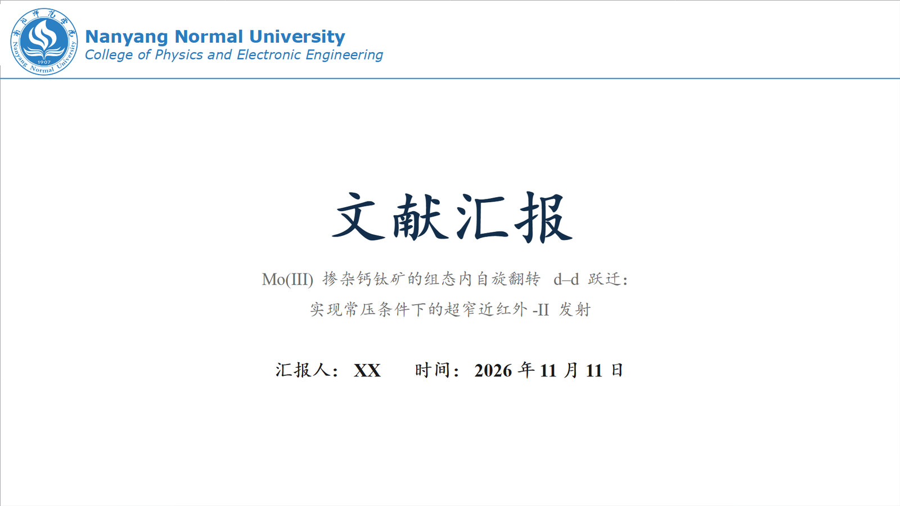
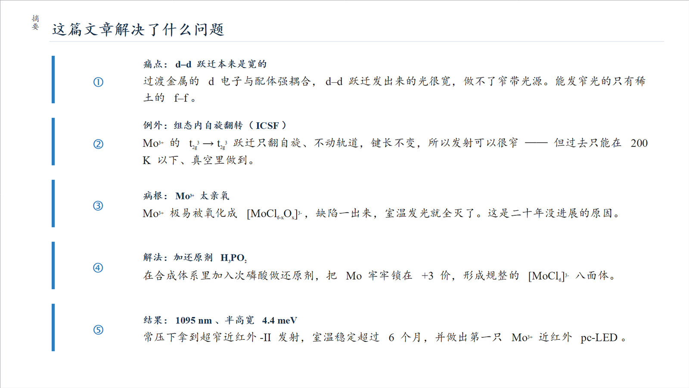
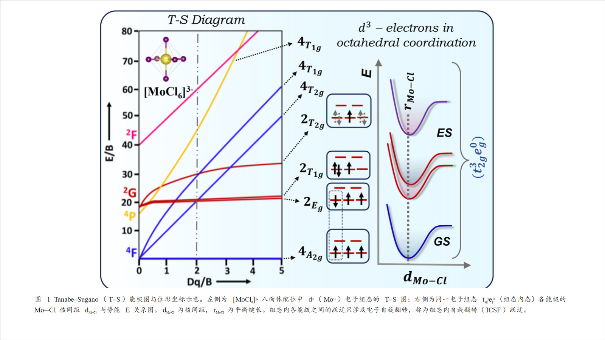
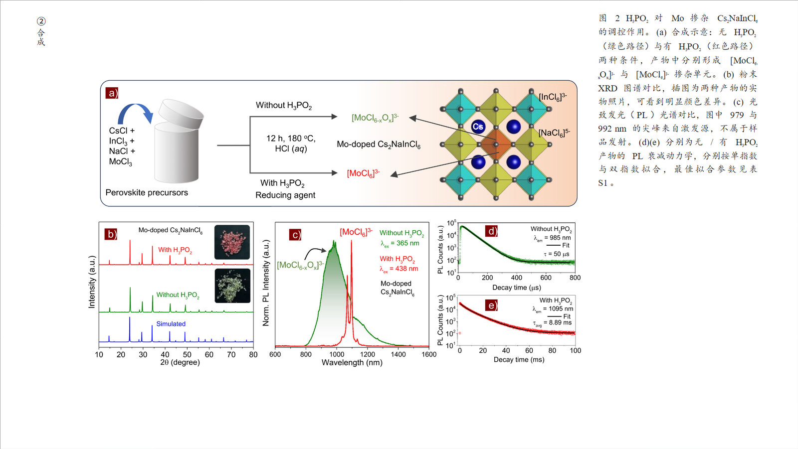
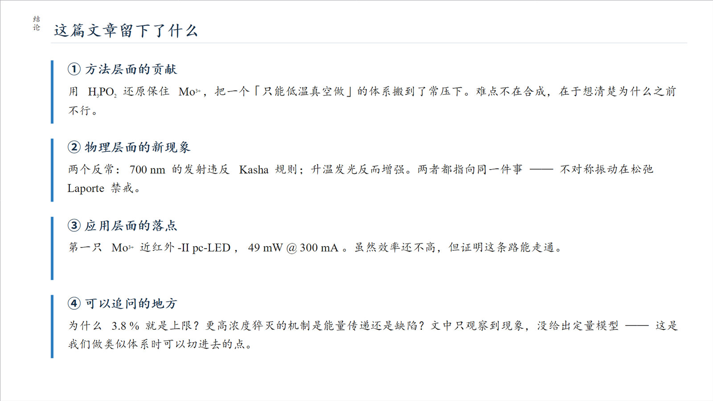
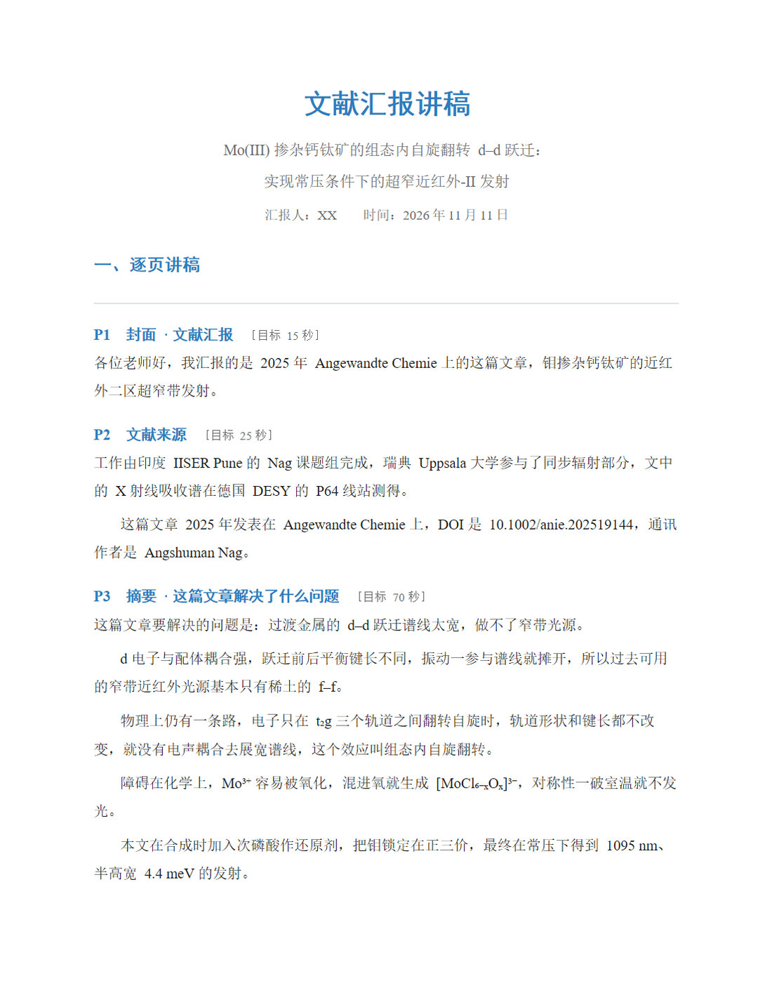
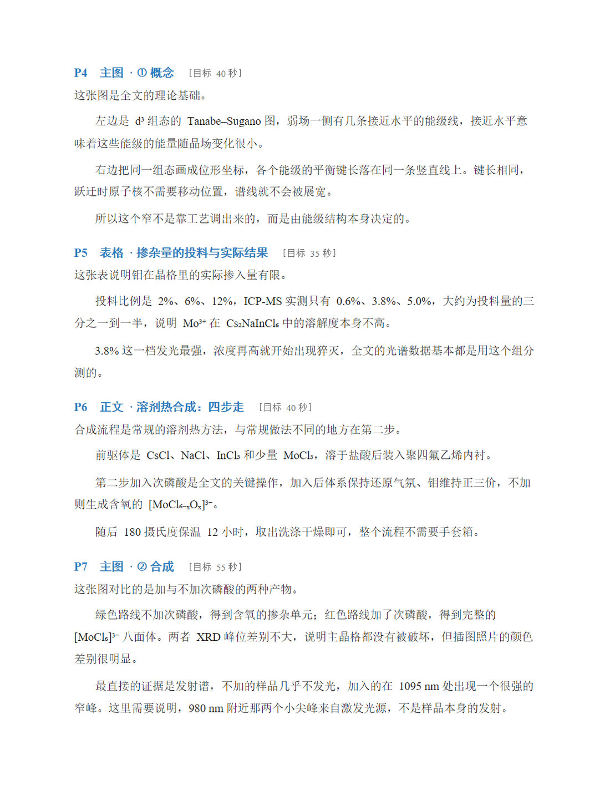
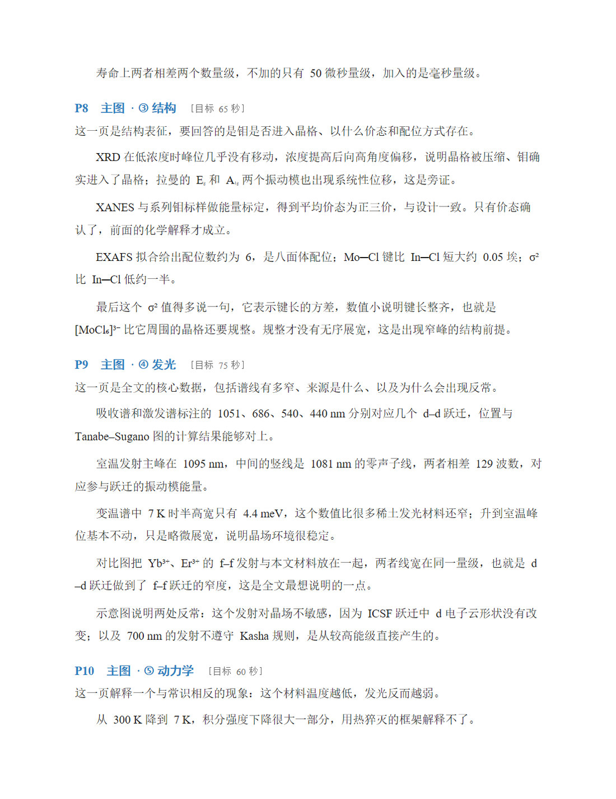
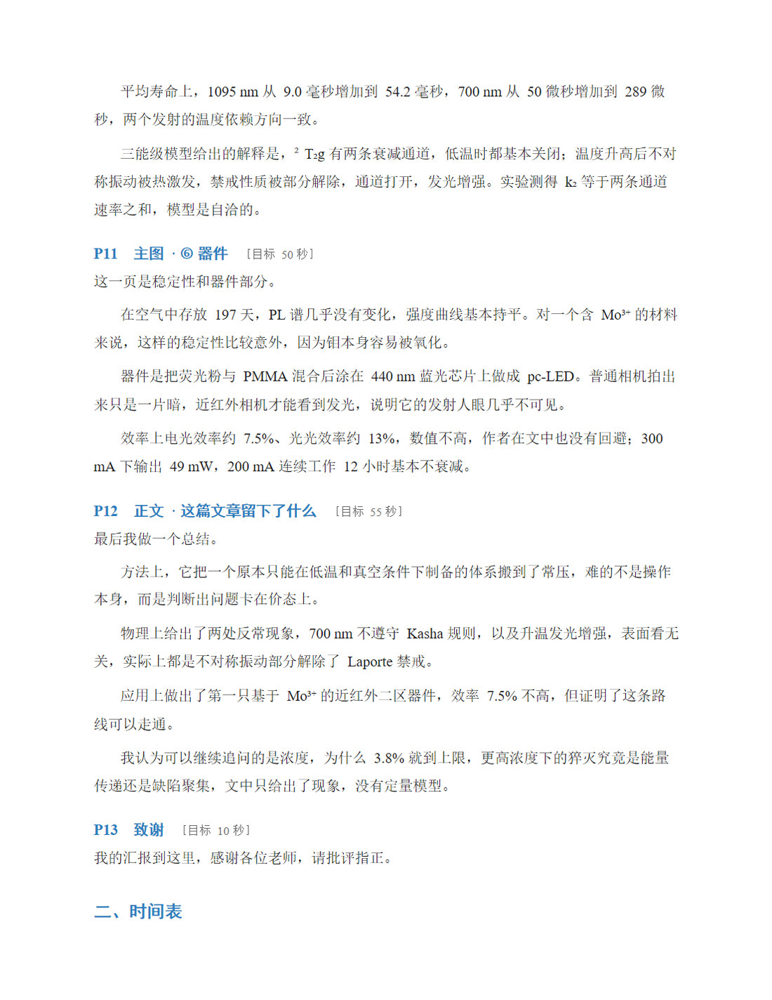
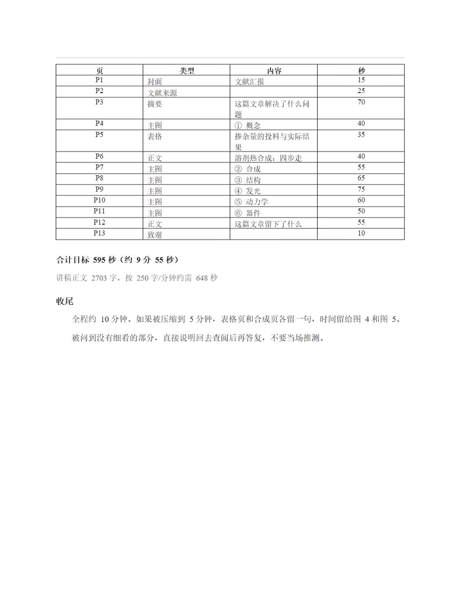

# 文献汇报 PPT

**一句话**：给一篇论文 PDF，出一份能上台讲的中文组会汇报 PPT，外加一份对着每页念的 Word 讲稿。

两个产物同源于一个 `content.json`，所以幻灯片上写的和嘴里讲的不会打架。版式和设计参数是从一份真实的组会汇报稿逐形状量出来的实测值，不是凭感觉设的。

不依赖任何特定 AI 平台 —— 底下就是几个普通 Python 脚本，有 shell 能跑 python 的地方就能用。

---

## 它能做到什么

组会文献汇报的流程是固定的：封面 → 论文首页截图 → 摘要精读 → 实验条件 → 合成方法 → 一张张主图配图注 → 结论 → 致谢。**每次都要重做一遍**，真正费时间的不是排版，是「图注写全」和「别把化学式上下角标打错」。

这个仓库把这两件事变成脚本：

| 你担心的 | 它怎么处理 |
|---|---|
| 图注偷懒，写「如图所示」 | 图注少于 40 字、缺子图交代 → 自检直接报错 |
| 图注太长，塞不进版面 | 按实际行数算，放不下就**开续页**，续页仍带同一张图 |
| 图注太短，图被压小 | 短注走底栏满宽排法，长注才走右栏 |
| 化学式上下角标 | 写 `Cr^{3+}`、`Cs_{2}NaInCl_{6}`，脚本转成真上下标 |
| 元素跑出画面被切 | 逐页扫描出界、重叠、字体缺失、字号越级 |
| 讲稿像念论文 | 讲稿按「一张图两三句、学术但不堆术语」的口径写 |

---

## 长什么样

下面这些是从同一篇 Mo³⁺ 掺杂钙钛矿论文做出来的成品截图，人名统一换成了 `XX`。**封面和致谢上的校徽、两行校名是默认值（南阳师范学院物理与电子工程学院），自用要换成自己的** —— 具体改哪三处见下面「改成你自己的学校」。

**PPT（挑 5 张典型页）**

| | |
|---|---|
|  |  |
| 封面：标题 + 汇报人 / 时间 | 摘要页：五条要点，纯文字版式 |
|  |  |
| 短图注走底栏满宽：图 + 底栏一行注 | 长图注走右栏：图缩到左侧，注单独一列 |
|  | |
| 结论页：四条并列 | |

**源文件也给了**：`examples/示例.pptx`（13 页）和 `examples/示例讲稿.docx`（5 页）就是上面截图的那两份，直接打开能改文字、换图、调版式，不用从零跑一遍脚本。想按自己的论文重做一份，还是走下面「用」的四步。

> 图里的人名是 `XX`、时间是 `2026年11月11日`，都是 `--presenter` / `--date` 传进去的占位值，跑一遍换成自己的即可。校徽和校名是默认值，自用要换（见「改成你自己的学校」）。论文图来自 Wiley 期刊，这里只作版式示例。

**Word 讲稿（全文 5 页，缩到和上面 PPT 截图一样大）**

讲稿按页写，一页 PPT 一段话，末尾带各页目标秒数与合计。它和 PPT 同源于一个 `content.json`，所以不会讲串。五页全留，但缩成两列缩略图放在这一节末尾，点开看大图 —— 竖页直接铺开一张占一屏，太占地方。

| | |
|---|---|
|  |  |
| 讲稿 P1 | 讲稿 P2 |
|  |  |
| 讲稿 P3 | 讲稿 P4 |
|  | |
| 讲稿 P5 | |

---

## 安装

```bash
pip install -r requirements.txt
```

就这四个依赖：`python-pptx`、`python-docx`、`Pillow`、`pymupdf`（`pypdf` 兜底）。

手动用这一套**不需要 `git`、不需要 Node、不需要 Office**。

> 如果你是 DSH 用户、想从插件市场装（`dsh plugin add wld12314/lit-report-ppt`）：仓库里多带了一个 `package.json` + `cordis.patch.yml` + `lib/index.js`，那是给 DSH 宿主注册这个 skill 用的登记表，跑在宿主侧、需要 Node 22+。**它不碰出稿脚本** —— 出稿还是上面那四个 Python 依赖，跟手动装法一模一样。

---

## 用

### 四步走

```bash
# 1. 抽正文、摘要、图注
python scripts/extract_paper.py paper.pdf -o work/

# 2. 裁图（先 --list 看清图片块的真实边界，别再靠猜坐标）
python scripts/crop_figures.py paper.pdf --list
python scripts/crop_figures.py paper.pdf --crop "5,0.080,0.065,0.930,0.445" -o work/figs/fig04.png

# 3. 填 content.json（复制 assets/content.template.json 改）
#    ↑ 这一步是判断活，脚本不替你写内容

# 4. 出稿
python scripts/build_deck.py content.json -o out/deck.pptx
python scripts/check_deck.py out/deck.pptx --content content.json
python scripts/build_script.py content.json -o out/讲稿.docx
```

`check_deck.py` 要跑到 **0 个建议**才算完成。

### 汇报人姓名与时间

默认印 `XX`。提前知道了就传参，或者写进 `content.json` 的 `meta.presenter` / `meta.date`：

```bash
python scripts/build_deck.py content.json -o out/deck.pptx --presenter "张三" --date "2026年11月2日"
python scripts/build_script.py content.json -o out/讲稿.docx   --presenter "张三" --date "2026年11月2日"
```

### 改成你自己的学校（自用必看）

仓库里的封面默认是**南阳师范学院物理与电子工程学院**，校徽和两行校名都是**写死在代码里的**，不是 `content.json` 的字段。**只换 `assets/logo.png` 不够** —— 不换校名，封面上照样顶着「Nanyang Normal University」。

三处都要改，一共就三行的事：

| 改什么 | 位置 |
|---|---|
| 校徽图片 | 直接覆盖 `assets/logo.png`（建议 1:1 正方形，白色或透明底，≥300×300） |
| 第一行校名 | `scripts/build_deck.py:53` 的 `"Nanyang Normal University"` |
| 第二行院系 | `scripts/build_deck.py:58` 的 `"College of Physics and Electronic Engineering"` |

两行都在 `_top_bar()` 里，改完重跑 `build_deck.py` 即可，`check_deck.py` 不用跟着改。

封面和致谢页各有一份顶栏，但它们是同一个函数画的，**改一处就够了**。

字号是照着「18pt 粗 + 14pt 斜体」这个组合配的：新校名比这长就把 `18` 往下调到 16，别让它顶到右边。真觉得别扭，把这两行喂给 AI 让它改也行。

---

## 页序（固定）

```
1   封面            标题 / 汇报人 / 时间
2   文章首页截图     + 作者信息卡        ← 全篇唯一允许全英文
3   摘要精读        ①②③④⑤
4   实验条件 / 表格
5   合成方法
6+  主图页 ×N       图 + 完整图注        ← 占全篇 70% 以上
末  结论
末  致谢
```

信息太多就拆两页，不要缩字号硬塞。

---

## 主图页有两种排法

不是审美选择，是**按图注实际占的行数**自动选的：

| 排法 | 图区 | 图注栏 | 适合 |
|---|---|---|---|
| A 底栏 | 11.71 × 6.20 | 底部 11.80 × 0.92 | 短图注，图满宽 |
| B 右栏 | 8.45 × 7.16 | 右侧 2.75 × 7.14 | 长图注，图靠左 |

两栏都放不下 → 自动开续页，续页把同一张图缩到上半页，剩下的图注铺在下半页。**只挪注不挪图是不行的** —— 讲这页时图不在旁边，图注里说的 (a)(b)(c) 全悬空。

---

## 自检查什么

`check_deck.py` 扫六类：

1. **出界** —— 形状跑出画布，多半已经被切掉了
2. **重叠** —— 两个形状压在一起（阈值 0.15 in）
3. **空图注** —— 少于 40 字
4. **字体缺失** —— 对照系统实际可用的字体文件
5. **字号越级** —— 不在 `{66,60,40,22,20,18,16,14,13,11,10}` 里
6. **缺图** —— `image` 指向的文件不存在

---

## 它是个 AI skill，也是组普通脚本

两种用法：

**A. 当 AI skill 用（推荐）** —— 把整个目录放进 agent 的 skills 目录：

| 平台 | 放哪 | 能跑脚本吗 |
|---|---|---|
| DSH | `~/.dsh/skills/lit-report-ppt/` | ✅ |
| Claude Code / Codex CLI / Cursor | 对应 skills / rules 目录 | ✅ |
| ChatGPT（自定义 GPT） | 把 `SKILL.md` 贴进 instructions | ❌ 见下 |

⚠️ **「通用」有个前提：那个平台得能执行本地的 Python 代码。**

脚本是普通 Python，跟平台无关 —— 只要有 shell 能跑 `python scripts/build_deck.py`，在哪儿都一样。

但网页版 ChatGPT 这类**没有代码执行能力**的，只能用它来写 `content.json` 里的文案和图注（那是判断活，它做得不错），最后一步出稿得在本机上跑。别指望在对话窗口里直接吐出 `.pptx` 文件。

`SKILL.md` 里写了什么时候该用它、四步走、**最容易错的六件事**、以及一节「裁图踩过的坑」 —— 这段给任何模型看都有用，因为它讲的是内容判断，不是 API。

**B. 纯手动用** —— 不接 AI 也行，就是跑上面那四条命令。模板和校徽按脚本所在位置解析（`__file__`），**跟当前工作目录无关**，在哪个目录跑都一样。

---

## 目录

```
SKILL.md                        主入口：什么时候用、四步走、最容易错的六件事、裁图踩过的坑
examples/                       成品示例：5 张 PPT 页 + 讲稿 5 页截图，以及可直接改的 .pptx / .docx
package.json                    DSH 插件市场登记表（声明 dsh.bundle）
cordis.patch.yml                bundle 补丁：注册 skill provider
lib/index.js                    provider 本体：读 SKILL.md 注册进宿主（需 Node 22+，不碰出稿脚本）
requirements.txt                python 依赖
references/style-tokens.md      几何 / 字号 / 颜色 / 图注容量（硬参数，改前先问）
references/page-skeleton.md     七种页型的字段结构与写法
references/script-guide.md      讲稿写作规范
references/copywriting.md       文案口径：什么话能说、什么话不能说
assets/template.pptx            空模板（母版 + 10 个版式，无页面）
assets/logo.png                 校徽（默认南阳师范学院，自用换成自己的）
assets/content.template.json    content.json 全字段样板
scripts/lr_common.py            设计常量 + 排版原语（改参数改这里）
scripts/extract_paper.py        抽正文与图注
scripts/crop_figures.py         裁图
scripts/build_deck.py           生成 PPT
scripts/check_deck.py           自检
scripts/build_script.py         生成 Word 讲稿
```

---

## 关于字体

模板原稿用的是「华文楷体」，多数 Windows 机器没装。仓库统一用**楷体**（`simkai.ttf`，Windows 自带）顶替，`check_deck.py` 会按本机实际可用字体检查。

另外三个都是系统自带：Times New Roman（西文正文）、Verdana（校名）、等线（序号）。

⚠️ **字体检查目前只认 Windows 的字体目录**（`%WINDIR%\Fonts`）。在 macOS / Linux 上跑，`check_deck.py` 会跳过这项检查（不报错），但生成的文件拿到 Windows 上打开时，缺的字体仍会被静默替换、版式会走样。跨平台用请先确认目标机器有楷体和 Times New Roman。

---

## 已知取舍

- **讲稿不写进 PPT 备注栏。** 备注栏放映时看不见，念的时候还得另开窗口，不如单独一份 Word 放旁边。
- **裁图不能全自动。** 期刊在图正上方印一行深红色小节标题，它的位置正好落在图的 bbox 里，脚本按 bbox 取并集就会把这条红字一起裁进来；a)/b)/c)/d) 面板编号块也是暗红色，用宽松阈值做红字检测会把它误判成标题。实测「红字行 + 其后第一个空白行」自动定出来的裁切线会削掉子图上半截。所以 `crop_figures.py` 只提供坐标裁切，判断交给人：裁完把每张图顶部 14%、底部 10% 拼成一张对照图扫一眼。踩坑清单在 `SKILL.md` 的「裁图踩过的坑」。
- **讲稿不必和 PPT 逐页一一对齐。** 两页图讲同一件事，合成一段更顺。用 `"p": "7-8"` 指定覆盖的页范围。
- **左上角竖排标签只留字、不画框。** 外框已删，文字保留并改为楷体 11pt 正文色，竖排方向不变（只出现在 B 排法页，A 排法左边塞不下）。`content.json` 的 `tag` 字段同时给讲稿生成器当页标题兜底。
- **不主动加原稿没有的元素。** 提炼条、橙色 callout、页码都拿掉了。想加先问。

---

## License

MIT
